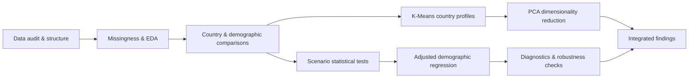

# Understanding Attitudes Toward Violence Against Women and Girls

### A cross-country statistical and unsupervised-learning analysis of demographic and social patterns


## Project Overview

Violence against women and girls is not only a behavioural and legal issue; it is also shaped by social norms and attitudes about when violence is considered acceptable. This project analyzes aggregated survey estimates from **70 countries** to understand how reported justification of violence against women varies across countries, genders, demographic groups, and different violence-justification scenarios.

The project goes beyond descriptive charts. It combines **exploratory data analysis, non-parametric statistical inference, effect-size analysis, adjusted regression, K-Means clustering, Principal Component Analysis (PCA), and model diagnostics** to build a defensible picture of the patterns present in the data.

A central methodological decision was **not to force a supervised predictive model onto data that were not designed for individual-level prediction**. The dataset contains aggregated subgroup estimates rather than respondent-level records, and the demographic dimensions are separate stratifications rather than jointly observed characteristics.

---

## Project Questions

The analysis focuses on four broad questions:

1. How do reported attitudes toward violence justification differ across countries and violence scenarios?
2. How do the reported percentages vary across gender, education, age, residence, employment, and marital-status groups?
3. Which demographic differences remain after accounting for country, gender, and scenario effects?
4. Do countries exhibit common multivariate response profiles across the five specific violence-justification scenarios?

---

## Dataset

| Item | Description |
|---|---|
| Dataset file | `Violence Against Women  Girls Data.csv` |
| Rows | **12,600** |
| Columns | **8** |
| Countries | **70** |
| Gender categories | **2** (`F`, `M`) |
| Violence measures | **6** total: 5 specific scenarios + 1 composite measure |
| Survey years | **2000–2018** |
| Non-missing `Value` observations | **11,187** |
| Missing `Value` observations | **1,413 (~11.2%)** |
| Outcome | `Value`: aggregate reported percentage |

### Variables

- `RecordID` — identifier for a country-year-question combination rather than an individual respondent.
- `Country` — country represented in the survey.
- `Gender` — female or male subgroup.
- `Demographics Question` — demographic dimension: age, education, employment, marital status, or residence.
- `Demographics Response` — category within the selected demographic dimension.
- `Question` — violence-justification measure.
- `Survey Year` — survey year associated with the country.
- `Value` — reported subgroup percentage.

### Important data structure

Each `RecordID` occurs **30 times**, reflecting the 2 genders × 15 demographic response categories attached to one country-year-question combination. These are **aggregate subgroup estimates**, not individual survey records.

The demographic dimensions are also **alternative breakdowns**, not jointly observed characteristics. For example, an education-based row does not simultaneously identify that subgroup's age, employment, marital status, and residence. This fact shaped the statistical modelling strategy used in the project.

> **Data source note:** add the original publisher or dataset URL here before publishing the repository if you have it. The final notebook identifies the dataset file but does not document an external source URL.

---

## Analytical Workflow



### Methods used

- Data validation, missingness analysis, and descriptive statistics
- Cross-country and demographic exploratory analysis
- Friedman test for paired scenario differences across countries
- Pairwise Wilcoxon signed-rank tests with Bonferroni correction
- Kendall's W and rank-biserial effect sizes
- K-Means clustering with elbow and silhouette diagnostics
- PCA for dimensionality reduction and interpretation of country profiles
- Adjusted OLS models with country, gender, and scenario controls
- Country-clustered standard errors with finite-cluster correction and t-based inference
- HC3 heteroskedasticity-robust inference as a robustness check
- Residual, heteroskedasticity, leverage, and Cook's-distance diagnostics
- Influence sensitivity analysis

---

## Key Results at a Glance

| Result | Finding |
|---|---|
| Scenario differences | Friedman statistic **178.01**, p ≈ **2.0 × 10⁻³⁷** |
| Overall scenario effect | Kendall's **W ≈ 0.664** |
| Post-hoc comparisons | **9 of 10** specific scenario pairs significant after Bonferroni correction |
| Most frequently highest specific scenario | **Neglecting the children: 48 of 70 countries** |
| PCA | PC1 explains **87.86%** of variance; PC1 + PC2 explain **92.48%** |
| K-Means | `k = 2` selected; silhouette score **0.494** |
| Cluster sizes | **43** and **24** countries among 67 complete-country profiles |
| Higher education vs no education | **−16.42 percentage points** adjusted |
| Secondary vs no education | **−7.90 percentage points** adjusted |
| Primary vs no education | **−2.54 percentage points** adjusted |
| Urban vs rural | **−7.40 percentage points** adjusted |
| Employed for kind vs unemployed | **+4.41 percentage points** adjusted |
| Employed for cash vs unemployed | Not statistically distinguishable from zero |

---

## 1. Gender Patterns

Across the available observations, female subgroup means were higher than male subgroup means for all six violence measures. The average female-minus-male gap across the six measures was approximately **7.04 percentage points**, with the largest observed gap for the scenario involving refusal to have sex (**8.02 percentage points**).

This result is interpreted cautiously because missingness is highly uneven by gender: male observations contain substantially more missing values than female observations. The analysis therefore treats these as descriptive differences among the available aggregate estimates rather than as definitive population-level statements about individual women and men.


---

## 2. Education Shows the Strongest Demographic Gradient

The descriptive and adjusted analyses tell the same broad story: reported justification declines as education level increases.

In the final adjusted specification, using **no education** as the reference category and accounting for country, gender, and violence scenario:

- Primary education: **−2.54 percentage points**
- Secondary education: **−7.90 percentage points**
- Higher education: **−16.42 percentage points**

The education gradient remains statistically detectable under country-clustered inference, HC3 robust inference, and influence sensitivity analysis. The higher- and secondary-education estimates are especially stable; the primary-education estimate is directionally robust but more sensitive in magnitude.


---

## 3. Residence Is Also Strongly Associated With the Reported Percentage

After adjustment, urban groups have reported values approximately **7.40 percentage points lower** than rural groups. This is one of the largest demographic contrasts in the final models, second only to the higher-education contrast.

Age and marital-status differences are statistically detectable but smaller. Employment is more nuanced: cash employment is not statistically distinguishable from unemployment, while employment for kind is associated with a higher reported percentage.


---

## 4. Violence-Justification Scenarios Differ Systematically

The five specific scenarios were analyzed separately from the composite measure, `... for at least one specific reason`.

The Friedman test provides strong evidence that the five specific scenario distributions differ across countries. Pairwise Wilcoxon tests show that **9 of the 10 scenario pairs** remain significant after Bonferroni correction. The only pair without a statistically detectable difference is:

- arguing with him vs going out without telling him.

Among the five specific scenarios, **neglecting the children** is the highest-valued scenario in **48 of 70 countries**. Burning the food is not the highest-valued specific scenario in any country.


---

## 5. Country Profiles: K-Means Clustering

Country-level clustering was performed using the five specific violence-justification scenario means. Only countries with complete values across all five scenarios were used, leaving **67 countries** for the multivariate analysis.

After standardization, the elbow method suggested a two-to-three cluster structure, while the silhouette score was highest at **k = 2 (0.494)**. The primary two-cluster solution contains **43 countries** in one profile and **24 countries** in the other.

The two clusters have similar profile shapes but differ substantially in their overall reported levels across all five scenarios. A three-cluster sensitivity analysis produces lower, intermediate, and higher profiles, supporting the interpretation that the main structure is closer to a **continuum** than to fundamentally discrete country types.


---

## 6. PCA Reveals a Dominant Common Dimension

PCA provides one of the clearest findings in the project:

- **PC1 explains 87.86% of the total variance** across the five specific scenarios.
- PC1 and PC2 together explain **92.48%**.
- All five scenarios load positively and almost equally on PC1, with loadings of roughly **0.44–0.46**.

This means the main source of cross-country variation is a broad common dimension shared across the five violence-justification scenarios rather than one scenario dominating the structure.

The K-Means clusters separate almost entirely along PC1, reinforcing the interpretation that clustering mainly partitions countries according to their position on this underlying continuum.


---

## Regression Strategy

A single regression containing age, education, employment, marital status, and residence as simultaneous individual-level features would be structurally incorrect because these dimensions are not jointly observed in the dataset.

Instead, each demographic dimension is modelled **separately**, while controlling for common contextual factors:

```text
Value ~ demographic category + gender + violence scenario + country
```

Country fixed effects account for persistent country-level differences, while final inference uses **standard errors clustered by country** to account for statistical dependence among multiple observations from the same country.

### Final adjusted effects

| Dimension | Comparison | Adjusted difference (pp) | 95% CI | p-value |
|---|---|---:|---:|---:|
| Education | Higher vs no education | **−16.42** | −18.66 to −14.18 | <0.001 |
| Education | Secondary vs no education | **−7.90** | −9.45 to −6.35 | <0.001 |
| Education | Primary vs no education | **−2.54** | −3.67 to −1.40 | <0.001 |
| Age | 25–34 vs 15–24 | −1.38 | −2.11 to −0.65 | <0.001 |
| Age | 35–49 vs 15–24 | −1.75 | −2.59 to −0.91 | <0.001 |
| Residence | Urban vs rural | **−7.40** | −8.66 to −6.13 | <0.001 |
| Employment | Employed for cash vs unemployed | −0.43 | −1.26 to 0.39 | 0.296 |
| Employment | Employed for kind vs unemployed | **+4.41** | 3.22 to 5.61 | <0.001 |
| Marital status | Married/living together vs never married | +1.18 | 0.17 to 2.19 | 0.023 |
| Marital status | Widowed/divorced/separated vs never married | +1.60 | 0.62 to 2.59 | 0.002 |

> These are **subgroup-level associations**, not individual-level causal effects.

---

## Robustness and Diagnostics

The education model was subjected to additional diagnostic checks because it produced the strongest demographic gradient.

- Model R²: **0.766**; adjusted R²: **0.760**.
- The Breusch-Pagan test strongly rejects constant residual variance, indicating heteroskedasticity.
- HC3 robust inference preserves all education conclusions.
- Standard errors clustered by country are substantially larger than conventional OLS standard errors, confirming that within-country dependence matters for inference.
- Cook's-distance screening flags **189 observations (6.42%)**, but no single observation dominates the model.
- Excluding the screened observations as a sensitivity check changes the higher-education coefficient by about **6.1%**, secondary by **11.7%**, and primary by **35.0%**. All remain negative and statistically significant.

The full-sample country-clustered model remains the primary specification; the reduced sample is used only as a stress test.

---

## Why a Supervised Predictive Model Was Not Used

This was a deliberate methodological decision.

A Random Forest, XGBoost model, or other supervised algorithm could technically be trained to predict `Value`, but that would not automatically constitute a useful prediction problem because:

- the rows are aggregated subgroup estimates rather than individual respondents;
- age, education, employment, marital status, and residence are alternative stratifications rather than jointly observed features;
- `Value` is already a reported aggregate percentage rather than a clearly defined future or individual-level outcome;
- random train-test splitting could place related observations from the same country in both sets, creating optimistic performance through country-specific leakage;
- each country has only one survey year, so the dataset is not a longitudinal forecasting panel.

The project therefore uses methods aligned with the data-generating structure: statistical inference for subgroup associations, PCA for latent structure, and clustering for country-level profile exploration.

A supervised prediction task would be more defensible with individual-level records, jointly observed demographics, repeated survey waves, external country-level predictors, or a clearly defined unseen target population.

---

## Practical Implications

The analysis suggests several areas for further investigation and program design. Education and rural/urban context show the largest adjusted demographic differences, indicating that interventions and follow-up research should pay particular attention to educational and geographic context. Scenario-specific results also show that attitudes are not uniform across different justifications, so awareness programs may benefit from addressing specific social norms rather than treating violence justification as a single undifferentiated belief.

The country profiles are best used to identify contexts where additional research may be valuable—not to rank countries or label societies as fixed cultural types.

---

## Limitations

- The observations are aggregated subgroup estimates, not individual respondent records.
- The demographic dimensions cannot be combined as simultaneous individual-level characteristics.
- The analysis is observational and supports association, not causal inference.
- Approximately 11.2% of `Value` observations are missing, with missingness unevenly distributed across gender, country, demographic category, and question.
- Male observations contain substantially more missing values than female observations.
- Each country is represented by a single survey year, so the dataset does not support within-country longitudinal trend analysis.
- Countries were surveyed in different years, which complicates direct cross-country comparison.
- The outcome measures reported attitudes toward whether violence is justified; they do **not** measure actual violence, victimization, or perpetration.
- PCA and K-Means are exploratory tools; cluster membership should not be interpreted as a permanent classification of countries.

---

## Repository Structure

```text
.
├── README.md
├── Notebook
    └──Gender Analysis.ipynb
├── data
    └──  Violence Against Women  Girls Data.csv
└── images/
    ├── adjusted_demographic_effects.png
    ├── cluster_profiles.png
    ├── country_scenario_heatmap.png
    ├── education_gender.png
    ├── gender_gap.png
    └── pca_country_profiles.png
```

---

## Tech Stack

- **Python**
- **Jupyter Notebook**
- **pandas / NumPy** — data manipulation
- **Matplotlib / Seaborn** — visualization
- **SciPy** — non-parametric statistical tests
- **statsmodels** — adjusted regression, clustered/robust inference, diagnostics
- **scikit-learn** — scaling, K-Means clustering, silhouette analysis, PCA

---

## Running the Project

Clone the repository, create or activate a Python environment, and install the required packages:

```bash
pip install -r requirements.txt
```

Then launch Jupyter:

```bash
jupyter notebook
```

Open `Gender Analysis.ipynb` and run the notebook from top to bottom. Keep the CSV in the same project directory unless you update the data-loading path in the notebook.

---

## Conclusion

This project demonstrates how aggregated social-survey data can support meaningful analysis when the modelling strategy respects the structure of the observations.

The strongest findings are a pronounced education gradient, a sizeable rural-urban difference, systematic scenario-level differences, and a dominant common cross-country dimension that explains nearly 88% of the variation across the five specific violence-justification measures.

The project also illustrates an important data-science principle: **the most sophisticated model is not always the most appropriate model**. Methodological choices should follow the research question and the data-generating structure rather than the availability of an algorithm.


